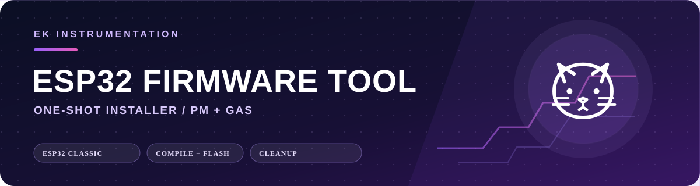
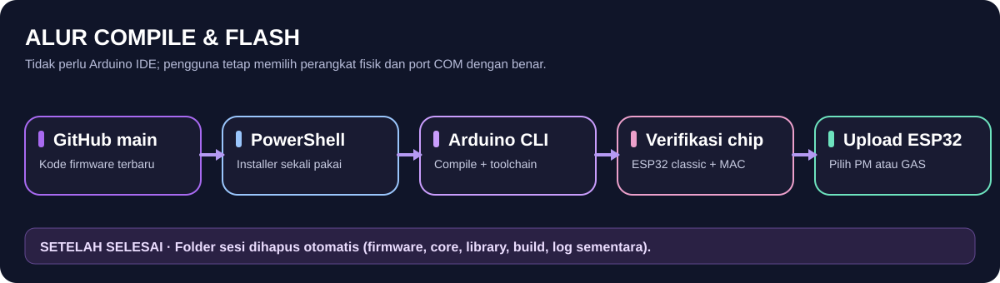

**Website resmi:** [**EK Instrumentation — ek-instrumentation.com**](https://ek-instrumentation.com)

<p align="center">
  
</p>

<p align="center">
  <a href="https://github.com/efendiyhy/pmgas-merge">Laptop Server</a> ·
  <a href="https://ek-instrumentation.com">Company Website</a>
</p>

# EK ESP32 PM & Gas — Firmware Installer

**Compiler dan uploader firmware berbasis PowerShell** untuk dua alat monitoring yang **berbeda secara fisik**: alat **PM** dan alat **Gas AQI**. Installer mengambil kode terbaru dari GitHub pada setiap sesi, menyiapkan lingkungan kompilasi Arduino CLI terisolasi, kemudian membersihkan berkas sesi setelah proses berakhir.

**Target:** ESP32 klasik (ESP32-WROOM-32 / ESP32 DevKit V1) · **Sistem operasi:** Windows 10/11 64-bit · **Tidak perlu:** Arduino IDE maupun library EspUsbHost.

## Instalasi cepat — Compile & Upload

Hubungkan **satu alat** ke port USB laptop, buka **Windows PowerShell**, lalu jalankan:

```powershell
irm https://raw.githubusercontent.com/efendiyhy/pmgas-esp32-firmware/main/install.ps1 | iex
```

Ikuti menu di terminal:

1. Pilih **Monitoring PM** atau **Monitoring Gas** sesuai alat yang benar-benar terhubung.
2. Installer menyiapkan Arduino CLI, ESP32 board core, dan library yang dibutuhkan.
3. Pilih **Compile Only** untuk memeriksa kode, atau lanjut ke proses upload.
4. Untuk upload, pilih port **COM**, lalu periksa identitas chip **ESP32 klasik** dan MAC address.
5. Konfirmasi firmware yang dipilih sebelum flashing. Jangan cabut USB selama upload.
6. Setelah berhasil, gagal, atau dibatalkan secara normal, installer membersihkan berkas sementara sesi tersebut.

> **Keamanan:** Menjalankan `irm | iex` mengeksekusi skrip dari internet. Tinjau [`install.ps1`](install.ps1) sebelum menggunakan dan pastikan alamat repository dapat dipercaya.

## Dua firmware, dua perangkat

| Firmware | Sensor utama | Penggunaan |
| --- | --- | --- |
| **PM Monitoring** | 2 × PMS5003T + SHT31 | Partikel PM1, PM2.5, PM10, suhu, dan kelembapan. |
| **Gas AQI Monitoring** | MH-Z19C + MiCS-4514 + SHT31 | CO₂, indikator CO/NO₂ sesuai kalibrasi firmware, suhu, dan kelembapan. |

Keduanya menggunakan ESP32 klasik, tetapi **wiring, pembacaan sensor, dan firmware tidak boleh dipertukarkan**. Jenis alat **tidak bisa dipastikan hanya dari port COM atau MAC address**, sehingga konfirmasi perangkat fisik tetap wajib.

## Alur installer

<p align="center">
  
</p>

**One-shot / tanpa instalasi permanen:** firmware, Arduino CLI portabel, ESP32 core, library, hasil compile, serta log sementara ditempatkan dalam folder sesi terisolasi di `%TEMP%` dan **dicoba dihapus otomatis saat sesi berakhir**. Setiap menjalankan perintah di atas, kode diunduh ulang dari branch `main`.

**Konsekuensi:** ESP32 board core berukuran besar; karena ikut dihapus, proses berikutnya perlu mengunduhnya lagi. Installer **tidak** menghapus Arduino IDE atau driver USB yang sebelumnya telah terpasang, dan tidak menghapus firmware yang sudah di-flash ke ESP32.

Pembersihan tidak dapat dijamin jika proses dimatikan paksa, Windows masih mengunci file, atau listrik terputus. Installer akan mencoba memberi tahu lokasi folder sesi yang tersisa.

## Setelah upload: buka dashboard ESP32

| Alat | Hotspot konfigurasi | Alamat dashboard |
| --- | --- | --- |
| PM | `PM-MONITOR-SETUP` | `http://192.168.4.1` |
| Gas | `AQI-SETUP` | `http://192.168.4.1` |

Password hotspot bawaan firmware referensi: `12345678`. Demi keamanan, ganti password sebelum penggunaan di lingkungan non-laboratorium.

Dari dashboard ESP32, pengguna dapat melihat data sensor meski tidak terhubung ke router, mencari jaringan **Wi-Fi 2,4 GHz**, mengatur koneksi Wi-Fi, memeriksa microSD, dan mengaktifkan pengiriman data ke laptop-server. Perubahan Wi-Fi Scan terbaru memprioritaskan pemindaian terhadap percobaan auto-reconnect saat router tersimpan tidak tersedia.

**MicroSD (SPI, asumsi kode):** CS `GPIO5`, SCK `GPIO18`, MISO `GPIO19`, MOSI `GPIO23`. Cocokkan konfigurasi pin dengan wiring alat nyata sebelum flashing.

## Integrasi dengan Laptop Server

Firmware mendukung pengiriman data ke aplikasi laptop dalam jaringan LAN yang sama. Jalankan [EK Air Quality Hub](https://github.com/efendiyhy/pmgas-merge), lihat IP laptop, lalu masukkan **alamat IPv4 saja** pada menu **Laptop Server** di dashboard masing-masing ESP32.

Contoh: `192.168.1.100` akan membentuk tujuan:

```text
http://192.168.1.100:8787/api/ingest
```

Pengiriman ke Supabase merupakan konfigurasi terpisah. Jangan memasukkan `service_role` key atau kredensial admin ke firmware yang disimpan secara publik. Gunakan pengaturan keamanan basis data sesuai kebutuhan aplikasi.

## Struktur source

```text
pmgas-esp32-firmware/
├── install.ps1
├── flash.ps1
├── README.md
├── firmware/
│   ├── PM_ESP32_CLASSIC/
│   │   ├── PM_ESP32_CLASSIC.ino
│   │   └── EK_Dashboard.h
│   └── GAS_ESP32_CLASSIC/
│       ├── GAS_ESP32_CLASSIC.ino
│       └── EK_Dashboard.h
├── assets/github/           # Gambar dokumentasi
└── .github/workflows/compile.yml
```

Sumber dashboard berada pada `EK_Dashboard.h`; file ini **harus tetap berada pada folder sketch yang sama** dengan `.ino` ketika dibuka secara manual melalui Arduino IDE.

## Persyaratan dan batasan

- Windows PowerShell 5.1+ dan koneksi internet saat proses installer.
- Kabel USB **data**, driver USB-Serial yang sesuai (misalnya CH340 atau CP210x), dan ruang penyimpanan sementara yang memadai.
- ESP32 klasik; ESP32-S2, ESP32-S3, ESP32-C3, dan proyek Muon **bukan target** installer ini.
- Port COM tidak boleh digunakan oleh Serial Monitor atau aplikasi lain saat flashing.
- Kompilasi otomatis memakai FQBN `esp32:esp32:esp32` dan Arduino-ESP32 core yang ditentukan oleh script.

**Status pengujian:** Pemeriksaan statis paket dan skrip bukan pengganti tes kompilasi sesungguhnya dan flashing pada hardware. Workflow `.github/workflows/compile.yml` menyediakan pengujian kompilasi saat dijalankan melalui GitHub Actions; hasilnya perlu dilihat pada tab Actions repository.

## Pemecahan masalah

| Gejala | Solusi awal |
| --- | --- |
| Tidak ada COM | Periksa kabel data, Device Manager, dan driver USB-Serial. |
| ESP tidak terdeteksi | Tutup Serial Monitor, cek port, ulangi sambungan USB, dan gunakan tombol BOOT bila diperlukan. |
| Gagal verifikasi chip | Pastikan benar-benar ESP32 klasik; installer menolak keluarga chip lain. |
| Proses download lama / gagal | ESP32 core besar. Pastikan koneksi stabil, ruang disk cukup, dan jalankan ulang installer. |
| Wi-Fi Scan kosong | Gunakan Wi-Fi 2,4 GHz, pastikan firmware terbaru terunggah, dan periksa log serial `115200`. |
| Gagal upload | Periksa suplai daya, port USB, dan identitas perangkat fisik yang dipilih. |
| Folder TEMP tertinggal | Tutup proses yang mengunci file; hapus hanya folder sesi `EK-PMGAS-ONESHOT-*` milik installer setelah proses benar-benar berhenti. |

## Bersih otomatis / uninstall

Tidak ada aplikasi firmware yang dipasang permanen oleh installer one-shot, sehingga tidak diperlukan uninstall biasa. File firmware dan toolchain sementara dibersihkan setelah sesi berakhir. Driver USB, Arduino IDE milik pengguna, data microSD, Supabase, dan [Laptop Server](https://github.com/efendiyhy/pmgas-merge) **tidak** ikut dihapus.

---

<p align="center">
  <a href="https://ek-instrumentation.com"><strong>EK Instrumentation</strong></a><br/>
  <sub>Environmental Monitoring · Embedded Systems · Data Acquisition</sub><br/>
  <a href="https://github.com/efendiyhy/pmgas-merge">Laptop Server</a> · <a href="https://github.com/efendiyhy/pmgas-esp32-firmware">ESP32 Firmware Tool</a>
</p>
